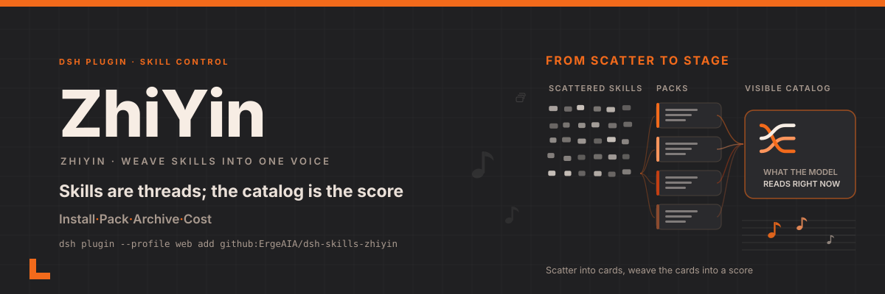

# ZhiYin



A skill-management plugin for DeepSeek Harness: install skills, group them into packs, switch them on and off.

English ｜ [中文](README.md)

> **What the name means**: **织** (weave) — turning scattered skills into one score; **音** (voice) — the single piece the model actually plays.
> Those two halves are the product: organise the skills, then decide which ones get to perform.
> Skills are the instruments, packs are the sections, and the catalog the model reads is the score — ZhiYin keeps that score.

ZhiYin turns "which skills can the model see right now" into something you can operate directly: what gets installed, which ones stay, and who has them on. It never edits skill files and never replaces DSH's own skill machinery — it only decides the visible set around them.

## Features

| Capability | Detail |
| --- | --- |
| Skill list | Totals, model-invocable count, catalog characters; sort by source, size or enabled state |
| Install | GitHub repository, one skill inside a repo, skills.sh page, `npx skills add` command, direct SKILL.md URL, or a local folder; pick individual skills when a repo contains several |
| Uninstall and archive | Uninstalling never deletes — the skill moves into an archive you can restore to its original location or elsewhere, or delete permanently |
| Per-skill toggles | Switches apply immediately and write local state only, never skill files |
| Skill packs | Group skills and switch each group as a unit; the default "All skills" pack is mutually exclusive with the others |
| Skill market | Search skills.sh and install any skill backed by a public repository |
| Config backup | Export/import JSON config, up to 20 backups kept for rollback |

## Install

Install into a profile as a DSH bundle:

```bash
# from a local folder
dsh plugin --profile <profile> add /path/to/dsh-skills-zhiyin

# from a tarball
npm pack
dsh plugin --profile <profile> add ./dsh-skills-zhiyin-0.1.0.tgz
```

After installing, **fully quit and reopen DSH** — the host half loads at process start, so reloading the page is not enough.

Requirements: Node.js ≥ 24; host-shared packages `@deepseek-ai/dsh-llm`, `@deepseek-ai/dsh-skill`, `@deepseek-ai/dsh-tools`.

## Usage

Two entry points, identical content: the **ZhiYin** row in the left sidebar, or Settings → ZhiYin. The book button in the app opens exactly this section.

<!-- guide:start -->

### 1. Installing a skill

Open **Skills → Install skill** and paste any of the following:

| Paste | Example |
| ---- | ---- |
| GitHub repository | `vercel-labs/skills` or `https://github.com/vercel-labs/skills` |
| One skill inside a repo | `https://github.com/vercel-labs/skills/tree/main/skills/find-skills` |
| skills.sh skill page | `https://www.skills.sh/vercel-labs/skills/find-skills` |
| skills CLI command | `npx skills add vercel-labs/skills --skill find-skills` |
| Direct SKILL.md URL | `https://example.com/my-skill/SKILL.md` |
| Local folder | `D:\my-skills\my-skill` |

If a repository contains several skills, ZhiYin lists them for you to tick. **Every ticked skill is installed flat into the chosen directory** — no extra repository folder is created.

### Choosing the target directory

| Directory | Who can use it | When to pick it |
| ---- | ---- | ---- |
| **Skill library ~/.agents/skills** | Every AI tool on this machine | Share one set of skills with Claude Code and friends |
| **User directory ~/.dsh/skills** | DSH only | Keep it for DSH alone |
| **Project .dsh/skills** | This project only | The skill only makes sense for one repository |

When installing into the skill library, ZhiYin also creates a **symlink** under `~/.dsh/skills` so DSH can see it. That is what the "link" badge on a card means; click it to jump to the real location.

### Or install from the market

**Skill market** searches skills.sh directly. Cards show the install count and the matching CLI command:

- Backed by a public GitHub repo → click **Install**;
- Domain-hosted only (e.g. `uizze.sh`) → click **View** to open the skills.sh page; these have no public repository, so no tool can install them directly;
- Already installed → shows **✓ Installed**; the refresh button beside it **reinstalls** (use it after an upstream update).

### 2. Three switch layers

| Layer | Controls | Where |
| ---- | ---- | ---- |
| **1. All skills** | Master gate over every visible skill | The default pack on the Packs tab |
| **2. Skill pack** | Whether this group may play | Each pack on the Packs tab |
| **3. Single skill** | The skill's own switch (the floor) | Each card on the Skills tab |

Key rule: **a pack only decides whether the group may play — it never forces its members on.** For a skill to be visible to the model it must belong to an enabled pack **and** not be switched off individually.

### 3. Working with packs

On the **Skill packs** tab:

1. Click **+ New pack** and name it (1–40 characters);
2. Open it and tick the skills it should contain;
3. Turn the pack on.

Packs can be **renamed, duplicated and deleted**. Deleting a pack only dissolves the group — **it never deletes the skills inside it**.

### "All skills" versus a normal pack

| | All skills | Normal pack |
| ---- | ---- | ---- |
| Members | Every visible skill, new ones join automatically | Whatever you tick |
| Editable (members / name / delete) | No, on/off only | Yes |
| Relationship to other packs | **Mutually exclusive** | Can run alongside others |

Mutual exclusion means: turning **All skills** on turns every other pack off; turning any normal pack on switches **All skills** off.

> Why: the two overlap in meaning. "Everything" and "only these groups" being on at once would constrain nothing.

### 4. Archive and restore

**Uninstall never deletes.** It moves the skill directory into the archive.

- Location: `<plugin state dir>/archive/`, each entry timestamped;
- Only skills living in directories ZhiYin manages can be uninstalled; bundled skills and external read-only sources cannot;
- On restore you choose the destination: **original location (recommended)**, skill library, user directory, or project directory;
- Archive entries can be deleted **one at a time or in bulk** — that step is a real, permanent delete and asks for confirmation.

### 5. Directory characters and cost

The header shows **Directory characters**, and each skill card shows its description length.

It estimates the skill catalog the model reads every turn: roughly `Σ description length (capped at 500) + 200`. **There is no hard limit** — it just shows you where the cost sits. Click the small icon next to it for the formula, industry reference ceilings, and optimisation advice.

Three effective ways to bring the number down: disable skills you do not use, tighten pack grouping, shorten overly long descriptions (the description decides whether the model picks the skill).

### 6. Backup, export and import

Buttons in the top right:

- **Export config**: a JSON file with packs, disabled skills and notes — portable to another machine;
- **Import config**: overwrites the current config and **backs it up first**;
- **Backups**: up to 20 kept, roll back to any of them;
- Importing a skill-pack txt exported by AI Vault also works.

If the config references skills that no longer exist, the consistency badge turns red; click **Repair** to drop those dangling references.

### FAQ

**Do I need to restart DSH after installing or toggling?**
No. Switches apply immediately; after installing, hit refresh once (top right). Only changing the plugin's own code needs a restart.

**What does the "link" badge mean?**
The skill is symlinked from `~/.agents/skills`; the real directory is elsewhere. Click the badge to jump there.

**Why is there no uninstall button on some skills?**
They are bundled or come from an external source. ZhiYin only toggles them and never touches their files.

**What does "some skills are not in any pack and do not play" mean?**
A skill is not contained in any enabled pack. Add it to a pack, or enable **All skills**.

**Where did an uninstalled skill go?**
The **Archive** tab. It was not deleted and can be restored at any time.

<!-- guide:end -->

## What it writes

| Location | When |
| --- | --- |
| `<DSH_HOME>/zhiyin-proto/state.json` | Whenever toggles, packs or notes change |
| `<DSH_HOME>/zhiyin-proto/events.ndjson` | Appended diagnostic log |
| `<DSH_HOME>/zhiyin-proto/archive/` | When a skill is uninstalled |
| `~/.dsh/skills`, `<project>/.dsh/skills`, `~/.agents/skills` | Only when you explicitly install or uninstall a skill |

Toggling and viewing **never** touch skill files. Installation and uninstallation only happen on explicit user action.

## Known limitations

- Disabling works by registering a strategy provider on every running agent; new sessions are hooked by polling;
- Catalog characters are an estimate (each description capped at 500 characters plus fixed overhead), not real token counts;
- Skills hosted only on a skills.sh domain, with no public repository, cannot be installed directly — the UI only links to them;
- In development; the version stays at `0.1.0`.

## Development

```bash
npm install          # install dependencies
node --check index.js
node --check client.js
npm pack --dry-run   # inspect what would be published
```

Host-half changes need a DSH restart; page-half changes only need a page reload.

## License

No open-source license chosen yet.
