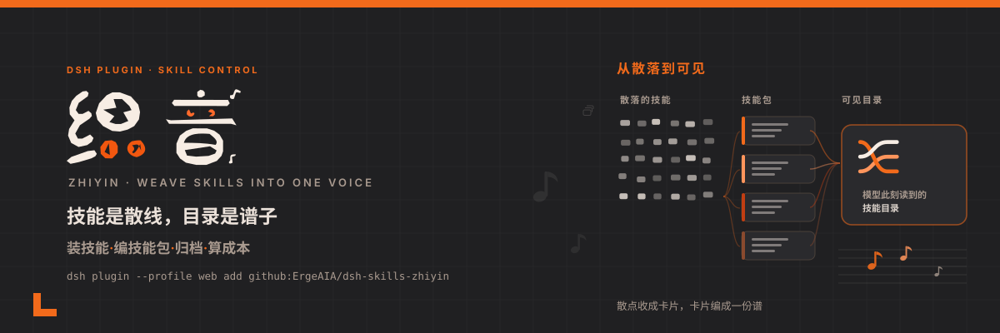

# 织音 · ZhiYin



DeepSeek Harness 的技能管理插件：安装技能、编成技能包、按需启停。

**English** ｜ [README.en.md](README.en.md)

> **「织音」是什么意思**：**织**——把散落的技能编成一支谱；**音**——模型此刻奏响的那一支。
> 名字里的两件事就是它做的事：把技能组织起来，并决定哪些上得了台。
> 零散的技能是乐器，技能包是声部，模型的目录是它真正演奏的乐章——织音管的就是这份谱子。

织音把「模型此刻能看见哪些技能」变成一件可以直接操作的事：装什么、留哪些、给谁开。它不修改技能文件本身，也不替换 DSH 的技能机制——只在外围决定可见范围。

## 功能

| 能力 | 说明 |
| --- | --- |
| 技能列表 | 汇总技能总数、模型可用数、目录字符数；按来源、字符数、启用状态排序 |
| 安装技能 | 支持 GitHub 仓库、仓库内单个技能、skills.sh 页面、`npx skills add` 命令、SKILL.md 直链、本地目录；一个仓库有多个技能时逐个勾选 |
| 卸载与归档 | 卸载不删除，移入归档目录；可恢复到原位置或指定目录，也可永久删除 |
| 单个技能启停 | 开关即时生效，写本地状态，不动技能文件 |
| 技能包 | 把技能分组，按组开关；「全部技能」默认包与其它包互斥 |
| 技能市场 | 搜索 skills.sh，直接安装有公开仓库的技能 |
| 配置备份 | 导出／导入 JSON 配置，最多保留 20 份备份可回滚 |

## 安装

已发布到 npm，推荐直接装：

```bash
dsh plugin --profile <profile> add dsh-skills-zhiyin
```

国内镜像源同步新包有延迟（表现为 404）。如果装不上，指定官方源：

```bash
dsh plugin --profile <profile> add dsh-skills-zhiyin --registry=https://registry.npmjs.org/
```

也可以从源码或 tarball 装：

```bash
# 从本地目录
dsh plugin --profile <profile> add /path/to/dsh-skills-zhiyin

# 从 tarball
npm pack
dsh plugin --profile <profile> add ./dsh-skills-zhiyin-0.1.8.tgz
```

安装后需**完全退出并重开 DSH**：宿主半边在进程启动时加载，刷新页面不生效。

从插件市场重装时，新版本受 pnpm 的「24 小时安全等待期」约束：刚发布的版本会先显示「新版等待中」，约 24 小时后才可安装。这是 npm/pnpm 与市场的默认安全策略，不是织音的限制，也不需要手动改配置。等不及的可以点市场里的「立即更新」显式放行。

运行要求：DSH ≥ `0.2.2-rc.5`（见 `package.json` 的 `engines.dsh`）。本包**无运行时依赖、无生命周期脚本**，安装不触发构建、也不需要额外的构建授权。

## 使用

装好后有两个入口，内容一致：左侧竖栏的「织音」，或 设置 → 织音。应用内右上角的书本按钮会直接打开下面这一段。

<!-- guide:start -->

### 一、装技能

打开「技能列表 → 安装技能」，把下面任意一种粘进输入框：

| 粘贴内容 | 举例 |
| ---- | ---- |
| GitHub 仓库 | `vercel-labs/skills` 或 `https://github.com/vercel-labs/skills` |
| 仓库里的单个技能 | `https://github.com/vercel-labs/skills/tree/main/skills/find-skills` |
| skills.sh 技能页链接 | `https://www.skills.sh/vercel-labs/skills/find-skills` |
| skills CLI 命令 | `npx skills add vercel-labs/skills --skill find-skills` |
| SKILL.md 直链 | `https://example.com/my-skill/SKILL.md` |
| 本地文件夹 | `D:\my-skills\my-skill` |

一个仓库里如果有多个技能，织音会把它们列出来让你勾选，**勾中的都平级装到所选目录**，不会多套一层仓库目录。

### 目标目录怎么选

| 目录 | 谁能用 | 什么时候选 |
| ---- | ---- | ---- |
| **技能库 ~/.agents/skills** | 本机所有 AI 工具 | 想和 Claude Code 等工具共用同一批技能 |
| **用户目录 ~/.dsh/skills** | 只有 DSH | 只想给 DSH 用 |
| **项目 .dsh/skills** | 只有当前项目 | 这个技能只对某个仓库有意义 |

装进技能库时，织音会顺手在 `~/.dsh/skills` 建一条**软链**，这样 DSH 才看得见它。技能卡上那个「软链」标记就是这个意思，点它可以跳到实体的位置。

### 也可以用市场装

「技能市场」直接搜 skills.sh 上的技能，卡片上会显示安装量和对应的 CLI 命令：

- 有公开 GitHub 仓库的 → 点「安装」直接装；
- 只有域名托管的（如 `uizze.sh`）→ 点「查看」跳到 skills.sh 页面看作者说明，这类没有公开仓库，任何工具都无法直接装；
- 已装的会显示「✓ 已安装」，旁边的刷新按钮是**重新安装**（技能更新后用）。

### 二、三层开关，各管一段

织音的开关有三层，优先级从高到低：

| 层 | 控制什么 | 在哪 |
| ---- | ---- | ---- |
| **1. 全部技能** | 一切可见技能的总闸 | 技能包页的默认包 |
| **2. 技能包** | 这一组技能能不能上场 | 技能包页的每个包 |
| **3. 单个技能** | 这个技能本身的开关（底线） | 技能列表的每张卡 |

关键规则：**包只决定「这一组能不能上场」，不会替成员强行打开**。所以一个技能要真正对模型可见，需要：所属包已启用 **且** 它自己没被单独关掉。

### 三、技能包怎么用

在「技能包」页：

1. 点 **+ 新建技能包**，起个名（1–40 个字符）；
2. 点开它，勾选要放进来的技能；
3. 打开这个包的开关。

包支持**改名、复制、删除**。删除只是解散这个分组，**不会删掉里面的技能**。

### 「全部技能」和其他包有什么区别

| | 全部技能 | 普通技能包 |
| ---- | ---- | ---- |
| 成员 | 自动包含所有可见技能，新装的自动加入 | 你手动勾选 |
| 能否改成员 / 改名 / 删除 | 不能，只能开关 | 都可以 |
| 和其他包的关系 | **互斥** | 可以和别的包同时启用 |

互斥的意思是：打开「全部技能」会把其他包全部关掉；反之打开任何一个普通包，「全部技能」会自动关掉。

> 为什么这样设计：两者语义重叠——「全都要」和「只要这几组」同时开着，等于没约束。

### 四、归档与恢复

织音的「卸载」**不是删除**，而是把技能目录**移进归档**。

- 位置：`<插件状态目录>/archive/`，每份归档带时间戳；
- 能卸载的只有装在自己管理的目录里的技能；内置技能和外部只读来源不能卸载；
- 恢复时可以选择恢复到：**原目录（推荐）**、技能库、用户目录、项目目录；
- 归档里可以**单条删除**，也可以勾选多条批量删除——这一步才是真正的永久删除，会二次确认。

### 五、目录字符数与成本

顶部会显示「目录字符数」和一个每个技能的描述字符数。

它算的是：模型每次对话都要读的技能目录，大约 `Σ 每个技能描述长度（封顶 500）+ 200`。**它没有硬性红线**，只是让你知道成本在哪。点旁边的小图标会给出计算方式、行业参考上限和优化建议。

想降低这个数字，最有效的三招：把用不到的技能停用、把技能包分组收紧、把过长的技能描述改短（描述决定模型会不会选中它）。

### 六、备份、导入导出

右上角的几个按钮：

- **导出配置**：生成一份 JSON，含技能包、停用项和备注，可带到另一台机器；
- **导入配置**：覆盖当前配置，**导入前会自动备份**；
- **备份列表**：最多保留 20 份，可回滚到任意一份；
- 导入 AI Vault 导出的技能包 txt 也可以。

如果配置里引用了已经删掉的技能，会出现「一致」变红的提示，点「修复」可以清掉这些指向空处的引用。

### 常见问题

**装完 / 开关之后要重启 DSH 吗？**
开关即时生效，不用重启；但**安装或升级插件本身之后要完全退出并重开 DSH**——宿主半边在进程启动时加载，刷新页面不够。

**卡片上的「软链」是什么意思？**
这条技能是从 `~/.agents/skills` 链过来的，实体在别处。点它可以跳到真实目录。

**为什么有的技能没有卸载按钮？**
它是内置技能或外部来源，织音只管启停，不动它的文件。

**「有技能未加入技能包，当前不生效」是什么意思？**
说明有技能没被任何启用中的包包含。把它加进一个包，或者启用「全部技能」。

**卸载之后技能去哪了？**
在「归档」页，随时可以恢复。它没有被删除。

<!-- guide:end -->

## 它会写哪些文件

| 位置 | 时机 |
| --- | --- |
| `<DSH_HOME>/zhiyin-proto/state.json` | 开关、技能包、备注等配置变化时 |
| `<DSH_HOME>/zhiyin-proto/events.ndjson` | 追加诊断日志 |
| `<DSH_HOME>/zhiyin-proto/archive/` | 卸载技能时移入归档 |
| `~/.dsh/skills`、`<项目>/.dsh/skills`、`~/.agents/skills` | 仅在你主动安装或卸载技能时 |

启停与查看**不会**改动任何技能文件。安装与卸载都只由你的显式操作触发。

## 已知限制

- 停用通过给每个运行中的 Agent 注册策略 provider 实现，新会话由轮询补挂；
- 目录字符数是估算值（每条描述截断到 500 字符 + 固定开销），不是真实 token 数；
- skills.sh 上仅域名托管、没有公开仓库的技能无法直接安装，界面只提供跳转；
- 版本按语义化版本递增；已发布到 npm，发布后的改动会体现在下一个补丁版本里。

## 开发

```bash
node --check index.js     # 宿主半边语法
node --check client.js    # 页面半边语法
npm pack --dry-run        # 查看发布内容（本包无依赖，无需 npm install）
```

宿主半边改动需要**完全退出并重开 DSH**；页面半边改动刷新页面即可。

发布：在 GitHub 发 Release（tag 与 `package.json` 版本一致）即由 `.github/workflows/publish.yml` 走 npm 可信发布（OIDC，无需令牌）；也可本地 `npm publish`。

## 许可

本项目采用 **Apache License 2.0**，全文见 [`LICENSE`](LICENSE)，署名信息见 [`NOTICE`](NOTICE)。

你可以自由地使用、修改、分发本项目，**包括用在闭源产品或商业产品里**——不要求你也开源。需要做的只有三件事：

- 保留版权声明与 `LICENSE`、`NOTICE` 两个文件；
- 你修改过的地方要注明（说明变更为你所作）；
- 不要用「织音 · ZhiYin」或作者名义为你的衍生产品背书。

许可证同时包含贡献者的**专利授权**（第 3 节）；商标权不在授权范围内。
